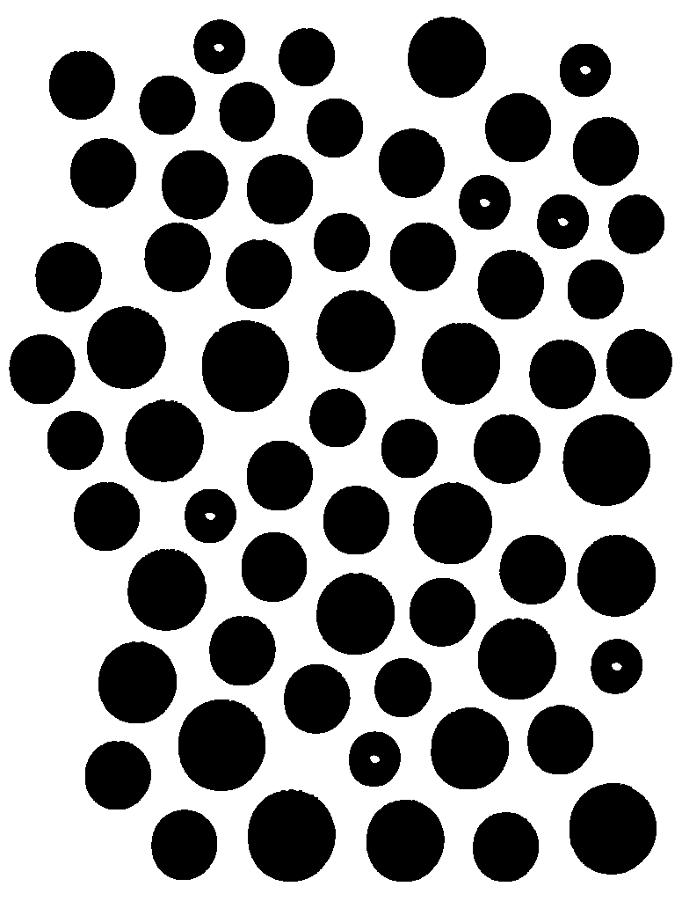

# DIP Coin Counter & Denomination Classifier

An end-to-end Digital Image Processing program that detects, segments, and classifies scattered Philippine Peso coins from an image, counts the quantity for each denomination, and calculates the total monetary denomination value without using 3rd-party vision libraries (such as OpenCV).

---

### Expected Output & Results

| Denomination | Face Value | Average Area (px) | Quantity | Subtotal |
| :--- | :---: | :---: | :---: | :---: |
| **5 Sentimos (5¢)** | ₱0.05 | ~2,832 | 7 coins | ₱0.35 |
| **10 Sentimos (10¢)** | ₱0.10 | ~3,438 | 11 coins | ₱1.10 |
| **25 Sentimos (25¢)** | ₱0.25 | ~4,722 | 28 coins | ₱7.00 |
| **1 Piso (₱1.00)** | ₱1.00 | ~6,572 | 13 coins | ₱13.00 |
| **5 Piso (₱5.00)** | ₱5.00 | ~8,217 | 5 coins | ₱25.00 |
| **Total** | | | **64 coins** | **₱46.45 PHP** |

---

### Program Output

```text
=================================================
   DIP Coin Counter & Denomination Classifier   
=================================================

Loading source image: C:\Users\krist\OneDrive\Desktop\Github\coin-image-processing\coins.jpeg
Image Dimensions: 776 x 1024 pixels
Stage 1: Grayscale conversion & threshold binarization...
Stage 2: Morphological dilation for reflection noise reduction...
Saved binarized image to: C:\Users\krist\OneDrive\Desktop\Github\coin-image-processing\coins_binarized.png
Stage 3: Connected-Component Analysis using Depth-First Search (DFS)...
Found 64 total components (64 valid coins after noise filter).

==========================================================================
Denomination         | Unit Value | Avg Area (px) | Quantity | Subtotal  
--------------------------------------------------------------------------
5 Sentimos (5¢)      | ₱0.05      | 2832         | 7        | ₱0.35     
10 Sentimos (10¢)    | ₱0.10      | 3438         | 11       | ₱1.10     
25 Sentimos (25¢)    | ₱0.25      | 4722         | 28       | ₱7.00     
1 Piso (₱1.00)       | ₱1.00      | 6572         | 13       | ₱13.00    
5 Piso (₱5.00)       | ₱5.00      | 8217         | 5        | ₱25.00    
==========================================================================
Total Coins Counted     : 64
Total Denomination Value: ₱46.45 PHP
==========================================================================
```

---

## How to Run

### Method 1: Running the Precompiled Executable
The program is compiled in the [executables folder](executables).

1. Open a terminal or Command Prompt inside the `executables` folder.
2. Run:
   ```cmd
   DIP_CoinCounter.exe
   ```
   *(Optionally pass a custom image path: `DIP_CoinCounter.exe path/to/image.jpeg`)*

### Method 2: Running via .NET CLI
From the root of this repository:
```bash
dotnet run --project DIP_CoinCounter/DIP_CoinCounter.csproj
```

---

## Image Processing Pipeline & Architecture

All image processing algorithms are implemented from scratch using basic pixel access, strictly complying with the restriction against third-party computer vision libraries:

```
[Raw Image: coins.jpeg]
        │
        ▼
[Stage 1: Grayscale & Luminance Thresholding] ──► Converts RGB to binary mask (isForeground)
        │
        ▼
[Stage 2: Morphological Dilation] ─────────────► Closes specular reflections inside coins
        │
        ▼
[Stage 3: Connected-Component DFS] ────────────► Identifies 8-connected blobs & pixel areas
        │
        ▼
[Stage 4: Natural Break Clustering] ───────────► Groups coins by area gaps into 5 denominations
        │
        ▼
[Stage 5: Denomination & Value Tally] ─────────► Computes subtotal per denomination & total ₱
```

### 1. Grayscale Conversion & Threshold Binarization
- Converts each pixel to luminance: $Y = 0.299R + 0.587G + 0.114B$.
- Pixels darker than `luminanceThreshold = 150` are marked as foreground coin pixels.

### 2. Morphological Dilation (Noise Reduction)
- Specular highlights and reflections can produce tiny white holes inside coin interiors.
- An 8-connected neighborhood kernel dilates coin boundaries to seal internal reflection pinholes while preserving coin shapes.
- Outputs `coins_binarized.png` for visual verification.

| Original (`coins.jpeg`) | Binarized (`coins_binarized.png`) |
| :---: | :---: |
|  |  |

### 3. Connected-Component Labeling (DFS)
- Traverses 8-connected foreground pixels using Depth-First Search (`dfsStack`) to extract discrete coin components.
- Rejects any components smaller than `minCoinPixelArea = 1000` to eliminate dust and scanning artifacts.

### 4. Natural Break Size Clustering
- Sorts `coinPixelAreas` in ascending order.
- Calculates pixel size gaps between consecutive coin sizes (`sizeGaps`).
- Selects the 4 largest size differences (`clusterBoundaries`) to partition the sorted coin areas into the 5 physical coin denominations.

### 5. Denomination Mapping & Monetary Totaling
- Maps each cluster to its corresponding physical denomination:
  - 5 Sentimos (5¢)
  - 10 Sentimos (10¢)
  - 25 Sentimos (25¢)
  - 1 Piso (₱1.00)
  - 5 Piso (₱5.00)
- Multiplies the quantity of each denomination by its unit face value to calculate subtotals and the overall monetary total (₱46.45 PHP).